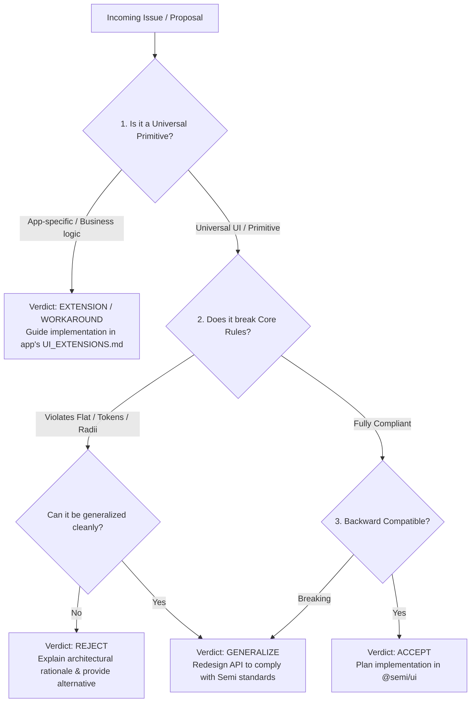

# Semi Design System Issue Triage & Architectural Analysis (`/semi-triage`)

Use this skill when working on the **Semi Design System repository** (`hoanghuynh296/semi-nextjs-codebase`) to review, analyze, and evaluate issues or feature proposals submitted by consumer projects (e.g. via `/semi-propose`).

The primary objective is to **satisfy the consumer project's genuine underlying need in a generalized way for the entire ecosystem WITHOUT breaking any Semi Design System rules**.

---

## The Triage Rubric (4 Core Dimensions)

Before accepting, modifying, or rejecting any proposal, evaluate it against these 4 dimensions:



### Dimension 1: Generalization vs Domain-Specific Logic
- **Universal Primitives (`@semi/ui`):** Layouts (`AppShell`), inputs, selects, pills, chips, modals, toolbars, cards, icons, semantic tokens. These belong in core `@semi/ui`.
- **Domain / Business Logic:** Data fetching logic, domain-specific state machines (e.g. Bambu MQTT slicing status, specific e-commerce checkout step). These **MUST NOT** be added to `@semi/ui`.
  *Verdict if domain-specific:* `WORKAROUND / EXTENSION` — explain how the consumer project can build it as a local extension adhering to `@semi/ui/styles`.

### Dimension 2: Semi Design System Rulebook Compliance
Run the automated compliance checker:
```bash
node "<path-to-plugin>/skills/semi-triage/scripts/triage.mjs" --issue <id> --audit
```
Check every element of the proposal against hard constraints:
1. **Surfaces & Theming:**
   - MUST use Semantic Tokens: `bg-canvas`, `bg-app`, `bg-panel`, `bg-field`, `bg-raised`, `text-contrast`, `text-body`, `text-muted`, `border-line`, `border-divider`.
   - MUST support Dual-Theme (`data-theme="dark"` and `data-theme="light"`).
   - STRICTLY BANNED: Raw physical palette classes (`bg-white`, `text-slate-900`, `border-slate-200`, `bg-slate-50`), gradients (`bg-gradient-*`), and drop shadows (`shadow-sm/md/lg`, `shadow-[0_0_...]`).
2. **Typography:**
   - Fonts: Geist for UI/body, Montserrat Alternates for display titles (`font-display`).
   - Weights: `font-medium` (UI/labels), `font-semibold` (headings/metrics). NEVER `font-bold`.
   - Sizes: Explicit px scale (`text-[11px]`–`text-[15px]`, `18px–22px` for KPIs, `22px–26px` for titles). NEVER `text-xs/sm/base`. Minimum `text-[11px]`.
   - Numbers: Always `tabular-nums`. `font-mono` ONLY for code. Sentence case only (no ALL CAPS).
3. **Radii:**
   - Standard scale: `rounded-lg` (controls/tiles), `rounded-xl` (cards), `rounded-2xl` (panels/modals), `rounded-full` (chips/pills).
   - NEVER `rounded-md`.
4. **Controls & Icons:**
   - NEVER native `<select>`, `type="date"`, `type="number"`, or `window.confirm`.
   - NEVER inline `<svg><path>` or unicode glyphs (✕ ✓ ✗ ⚠). Always use `<Icon name="..." />` from `src/iconCatalog.ts` (stroke 1.75).

### Dimension 3: Generalization Plan (How to solve it without breaking rules)
If the user or agent proposed a design that violates rules (e.g., they asked for a "white card with shadow-md" or "gradient badge"):
- **Do not simply reject!** Unpack the *real need* behind their request.
  - Need: "I want this card to stand out." $\rightarrow$ Solution: Use `CARD_ACTIVE` (border-primary) or `bg-raised` surface elevation.
  - Need: "I need to display tags with count badges." $\rightarrow$ Solution: Add a `badge` prop or accessory slot to `Chip` or `Pills` using semantic `COUNT_PILL`.
  - Need: "I need a date range." $\rightarrow$ Solution: Expand `DatePicker` with `mode="range"` or create `DateRangePicker` using existing calendar popups and tokens.

### Dimension 4: Implementation Roadmap
When accepted or generalized, specify exact touchpoints:
- Design Tokens (`tokens/tokens.json` $\rightarrow$ `build-tokens.mjs` $\rightarrow$ `tokens/tokens.css`)
- Style Constants (`styles/surfaces.ts`, `styles/buttons.ts`, `styles/appChrome.ts`)
- Components (`src/*.tsx`)
- Linter (`lint/semi-lint.mjs`)
- Documentation (`docs/DESIGN_SYSTEM.md`, `docs/QUICK_REF.md`, `docs/DECISIONS.md`, `CHANGELOG.md`)

---

## Workflow for the Triage Agent

### Step 1: List and Fetch Proposals
```bash
# List all open proposals
node "<path-to-plugin>/skills/semi-triage/scripts/triage.mjs" --list

# Inspect a specific proposal with automated rule audit
node "<path-to-plugin>/skills/semi-triage/scripts/triage.mjs" --issue <issue-number> --audit
```

### Step 2: Formulate the Triage Review Report
Create an architectural response formatted as follows:

```markdown
## 📋 Semi Architectural Triage Report: Issue #<id>

### 1. Request Summary & Core Need
- **Submitting Project:** [Project name]
- **Core Requirement:** [Extracted generalized problem]
- **Proposed Solution:** [What was requested]

### 2. Rule Compliance & Design System Audit
- **Surfaces & Tokens:** [PASS / NEEDS_REVISION — explain compliance with bg-panel, text-contrast, etc.]
- **Dual-Theme Compatibility:** [PASS / NEEDS_REVISION — Dark & Light behavior]
- **Typography & Radii:** [PASS / NEEDS_REVISION — rounded-lg/xl, medium/semibold]
- **Icons & Controls:** [PASS / NEEDS_REVISION — standard Icon & CustomSelect]

### 3. Generalization & Alignment Plan
[Detail how the system will generalize this capability so that:
1. The consumer's requirement is 100% met.
2. The solution is universal across all Semi apps (SaaS, 3D, IoT, E-commerce).
3. No Semi Design System rules are compromised.]

### 4. Verdict
- **Decision:** [ACCEPT | GENERALIZE | WORKAROUND / EXTENSION | REJECT]
- **Rationale:** [Clear architectural explanation]

### 5. Implementation Roadmap (if ACCEPT or GENERALIZE)
- [ ] `tokens/`: [Token updates if any]
- [ ] `styles/`: [Style constant updates]
- [ ] `src/`: [New component or prop additions]
- [ ] `lint/`: [Linter updates or baseline changes]
- [ ] `docs/`: [Update DESIGN_SYSTEM.md, QUICK_REF.md, DECISIONS.md]
- [ ] Verification: `npm run check` & `npm run build:storybook`
```

### Step 3: Post the Triage Feedback to GitHub
To communicate the evaluation back to the submitting project or issue author:
```bash
node "<path-to-plugin>/skills/semi-triage/scripts/triage.mjs" --comment <issue-number> --body "<review-markdown>"
node "<path-to-plugin>/skills/semi-triage/scripts/triage.mjs" --label-issue <issue-number> --add-labels "accepted,enhancement"
```

### Step 4: Execute Implementation
If the verdict is `ACCEPT` or `GENERALIZE`, proceed with the implementation roadmap in the repository, verify with `npm run check`, update documentation and release the next version tag so the consumer project can run `/semi-update`.
